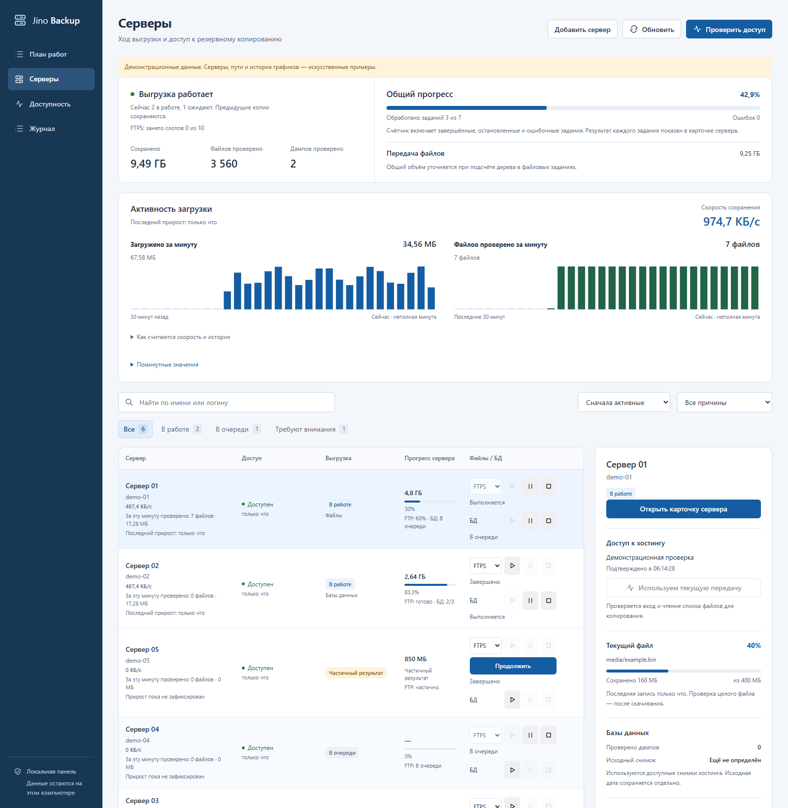
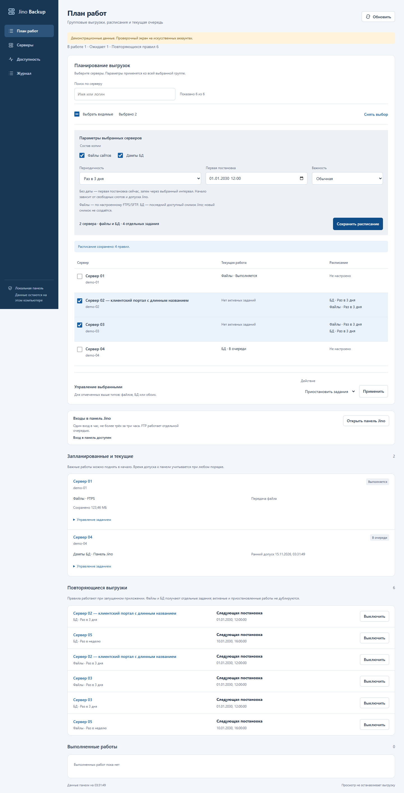
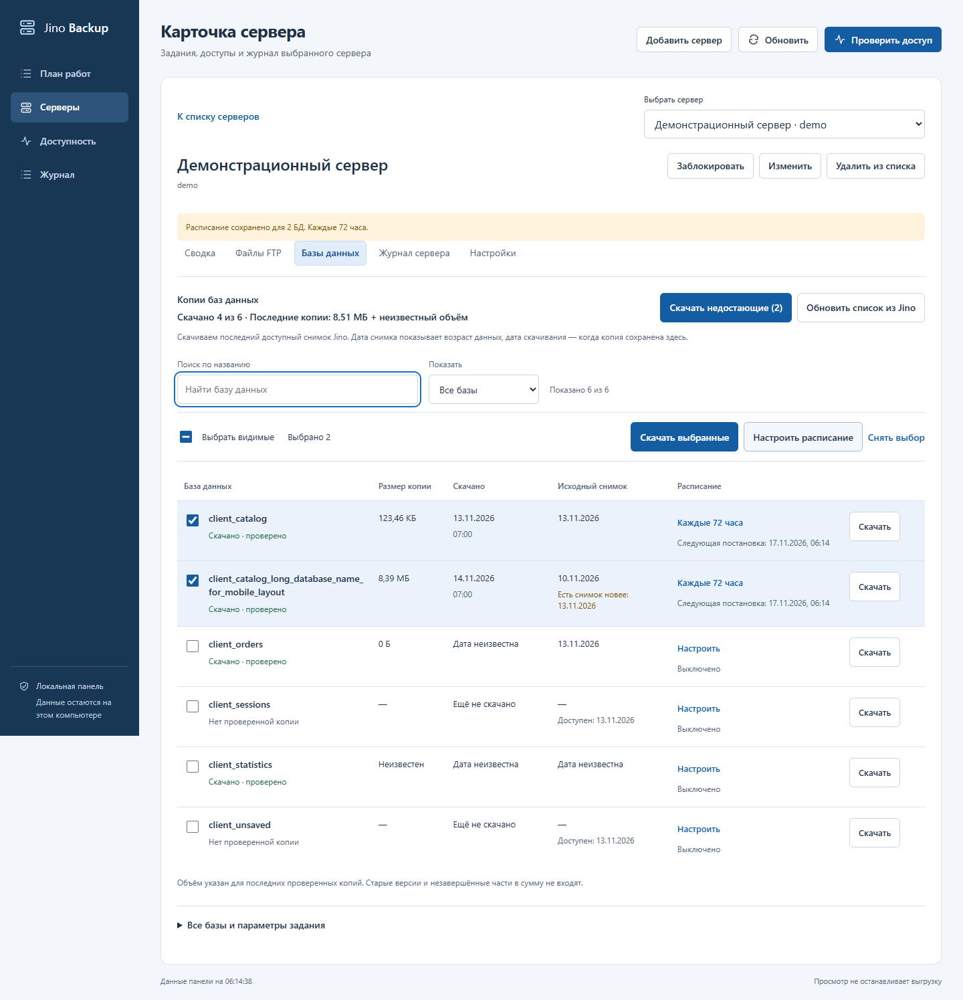
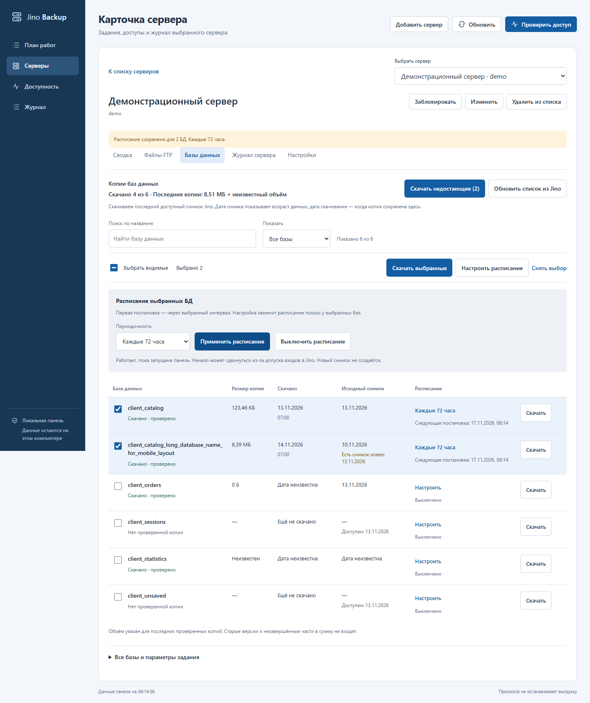
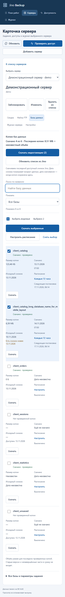

# Jino Backup Manager

Завершённый дамп без объектов БД сохраняется с предупреждением `SQL_NO_OBJECTS`; остальные БД продолжают выгружаться. Проверьте, ожидается ли пустая база. Подробнее — [обработка пустого дампа](docs/44_empty_database_warning.md).

При `DB_INTEGRITY_FAILED` управляемая очередь автоматически повторяет скачивание дампа: до трёх попыток с прежним ключом и допуском панели. Повреждённая версия сохраняется до проверки и атомарной замены. [Правила и ограничения](docs/43_database_integrity_redownload.md).

В **«Плане работ»** можно выбрать группу серверов, включить файлы и/или БД, управлять заданиями и задать один из 13 периодов — от 3 часов до года. Месяц считается как 30 дней, год — 365. [Групповые операции и расписания](docs/42_work_plan_bulk_schedules.md).

Конфликты файлов: сравнение содержимого, обновление известных более старых копий с сохранением прежних байтов и выбор действия в карточке без остановки остальных файлов описаны в [руководстве по конфликтам](docs/41_file_conflicts_and_scoped_errors.md). Неразрешённые конфликты дают `PARTIAL`.

Локальное приложение для резервного копирования сайтов с Jino.ru: браузерная панель на этом компьютере и CLI `backupctl`. Позволяет скачивать файлы, получать дампы MySQL из существующих снимков панели, управлять очередью и продолжать прерванные выгрузки. Текущая версия — прототип **0.1.0**, состояние документации сверено с кодом **15 ноября 2026 года**.

Основной выбранный режим — обычные файлы в `F:\jino`, в отдельных папках по логинам серверов. Архивный CLI отдельно сохраняет зашифрованные пакеты в каталог из настроек. Секреты хранятся отдельно от копий; TLS и ключ сервера SFTP проверяются.



*Основной экран заново снят 14 ноября с текущего кода. Серверы, логины, пути и история графиков — искусственные примеры; клиентские данные для снимка не читались.*

<details>
<summary>Ещё экран: план работ</summary>



В «Плане работ» настройки расписания постоянно видны, поля и выбор строк оформлены как в карточке БД. Поиск сохраняет выбранные серверы; в каждой строке показаны текущая работа и действующие расписания. [Устройство и проверки интерфейса](docs/45_work_plan_interface.md).

</details>

[Галерея всех экранов](docs/screenshots.md): серверы, план работ, копии БД, групповое расписание и мобильный вид.

## Возможности и ограничения

| Область | Что реализовано |
| --- | --- |
| Управление | Название сервера открывает карточку, остальная строка переключает правый блок; добавление и изменение настроек, блокировка, удаление записи с сохранением копий |
| Задания | Раздельные файлы и БД, запуск/пауза/продолжение/остановка, порядок, приоритет и раннее время начала |
| Прогресс и журналы | Общий прогресс очереди, совокупный прогресс FTP+БД по серверу, активные файлы, причины ошибок, журналы каталогов и пропущенных имён |
| Передача файлов | FTPS, SFTP при установке extra, HTTPS-менеджер панели; checkpoints, отдельная проверка артефактов, докачка, пропуск несовместимых имён и известных специальных объектов (последних — в управляемом FTPS/SFTP) с результатом `PARTIAL` |
| БД | Статус, размер и две даты каждой копии; скачивание всех, выбранных или только недостающих дампов; групповые расписания; отдельно прямой `mysqldump` при разрешённом доступе |
| Архивный CLI | Явные привязки сайта/БД, зашифрованные архивы, проверка чтения, интервальное расписание, извлечение в новый каталог |

Управляемая очередь выполняет **до пяти файловых заданий в бюджете 10 сеансов и одного БД-задания**. FTPS/SFTP и БД одного сервера могут выполняться одновременно; HTTPS-файлы и БД одного сервера последовательны. Повтор одного вида работы запрещён; пауза сохраняет слот. FTPS использует **2–5 сеансов на сервер**, по умолчанию 3, включая сеанс метаданных; общий предел — **10**. Панельные входы ограничены одним в час и тремя за скользящие три часа; CAPTCHA требует действия оператора. Эти ограничения входов не распространяются на старые самостоятельные массовые CLI-команды — их нельзя запускать одновременно с управляемой очередью.

Сеансы выдаются по фактическому запросу, без полного предварительного резерва на каждое задание. Простаивающий файловый сеанс освобождается при спросе другого сервера; SFTP и HTTPS-файлы занимают по одному слоту. Проверка записанного файла выполняется отдельно от передатчика, а результат ждёт успешной проверки. Общие диск и последовательный сеанс метаданных всё ещё влияют на скорость; равная с FileZilla скорость не подтверждена. [Оптимизация очереди и проверки](docs/39_ftp_performance_fixes.md).

После фактического начала новой файловой или БД-выгрузки прежние ошибки соответствующего типа скрываются из текущих предупреждений. История остаётся в отчётах и журналах; новые ошибки видны, даже если их код совпал со старым. [Правила сброса](docs/37_superseded_errors.md).

Автоматическое создание нового снимка командой приложения, подключение панельного экспорта к архивному `auto`, PostgreSQL/SSH-экспорт, S3/Object Lock, retention, внешние уведомления и проверка запуска восстановленного приложения **не реализованы**. Обычная локальная папка не обеспечивает неизменяемость копий.

`FILES_ONLY`, `DB_ONLY` и `PARTIAL` показывают неполноту копии. `COMPLETE` архивного workflow требует подтверждённого состава БД, успешного экспорта каждой базы, проверки файлов, архива и чтения записанной копии. Отдельные успешные задания FTP и БД в UI автоматически не объединяются в `COMPLETE`. Живые файлы и несинхронизированные SQL имеют согласованность `BEST_EFFORT`; дата исходного снимка учитывается отдельно от даты скачивания.

## Быстрый запуск панели

Нужны Python 3.11+ (для нового развёртывания рекомендуется 3.12+), исходный JSON и проверенная [карта полей](examples/jino-mapping.json). Для работы с панелью Jino установите Google Chrome и extra `panel`. Команды PowerShell из корня проекта:

```powershell
python -m venv .venv
.venv\Scripts\python.exe -m pip install -e ".[panel]"
```

На **новой установке** создайте настройки и ключ. Существующий проект повторно инициализировать не нужно:

```powershell
.venv\Scripts\backupctl.exe init --backup-dir C:\JinoBackup\archives --key-file C:\JinoBackup\keys\master.key
```

После размещения секретного исходного JSON запустите:

```powershell
.venv\Scripts\backupctl.exe ui --file abw_sibds__server.json --mapping examples/jino-mapping.json --destination F:\jino --batch-id local-ui --open
```

Панель доступна только на этом компьютере: **http://127.0.0.1:8765/**. Открытие страницы не заказывает новый бэкап. Сохранённая очередь продолжает выполнение при запуске исполнителя. Прерванные файловые задания могут автоматически вернуться в отложенный план с прежним ключом, если привязка не изменилась и не исчерпан срок 24 часа. Ручные паузы и остановки сохраняются; прерванные задания БД требуют ручного продолжения. Для первого запуска без истории обязательны `--destination` и `--batch-id`; в настроенной рабочей папке их можно брать из метаданных прежнего массового прохода.

Для SFTP установите `.[sftp]` и укажите проверенный `known_hosts`. Активация окружения и изменение политики PowerShell не требуются; на Linux пути исполняемых файлов находятся в `.venv/bin/`. Подробности: [панель и источники прогресса](docs/14_local_dashboard.md), [управление и очередь](docs/15_management_and_work_plan.md).

## Как скачать и планировать дампы БД

Нажмите название сервера и откройте вкладку **«Базы данных»**. В списке показаны последние проверенные копии, их размеры, даты скачивания и исходных снимков. «Есть снимок новее» означает, что в справочнике известен более свежий снимок, чем сохранённый.



*Синтетический пример интерфейса на 14 ноября. Названия, размеры и даты демонстрационные; скриншот не содержит клиентских данных.*

<details>
<summary>Скриншоты группового расписания и мобильной карточки</summary>





</details>

1. Если названия ещё не получены или список неполон, нажмите **«Обновить список из Jino»**. Это ставит чтение списка в очередь и не заказывает SQL.
2. Для ранее не скачанных дампов нажмите **«Скачать недостающие (N)»**. Одно задание получит все известные БД этого сервера без проверенной копии, независимо от поиска, фильтра и выбранных строк. Уже проверенные копии, включая старые снимки, пропускаются.
3. Для конкретных БД отметьте строки и нажмите **«Скачать выбранные»**. Поиск и фильтры помогают найти строки; **«Выбрать видимые»** относится только к текущему фильтру. Счётчик показывает весь выбор, в том числе скрытые фильтром строки.
4. Для повторения отметьте БД → **«Настроить расписание»** → **«Раз в неделю»**, **«Каждые 72 часа»** или свой интервал → **«Применить расписание»**. Допустимо целое число от 1 до 8760 часов. Первое планирование назначается через выбранный интервал; выключить расписание можно сразу для всей выбранной группы.

При существующем БД-задании кнопки новой выгрузки отключены. Управление заданием и ручная дата снимка доступны в раскрываемом блоке **«Все базы и параметры задания»**. Файловое задание FTPS/SFTP не мешает отдельной БД-очереди.

Используется **последний доступный существующий снимок Jino**; приложение не создаёт свежий снимок живой БД. Дата скачивания не заменяет дату исходных данных. Повторное использование проверенной копии того же снимка не обновляет время её скачивания. Сумма размеров относится к последним проверенным копиям, без старых версий и незавершённых частей; неизвестный размер не считается нулевым.

Расписания работают при запущенном исполнителе. Время в строке — следующая постановка, а не гарантированное начало или завершение. БД с одинаковыми интервалом и временем постановки объединяются в одно задание; часовой допуск панели и CAPTCHA сохраняются. [Полные правила, API и проверки](docs/40_database_catalog_and_bulk_schedules.md).

## Разработка и проверки

Для полного набора локальных проверок установите зависимости разработки и панельного адаптера; браузерные сценарии используют установленный Chrome:

```powershell
.venv\Scripts\python.exe -m pip install -e ".[dev,panel]"
.venv\Scripts\backupctl.exe --help
New-Item -ItemType Directory -Force -Path .test-tmp | Out-Null
.venv\Scripts\python.exe -m pytest -q --basetemp .test-tmp/validation
```

Прогон этапа карточки БД 14 ноября: **362 passed, 1 skipped**, 69,80 с. После уточнения восстановления групп прошли семь целевых тестов. Дополнительно выполнены **22 JS-теста** и синтетические браузерные проверки на 1440/1000/800/390 px, включая кнопку скачивания недостающих. Эти результаты не подтверждают работоспособность всех аккаунтов или завершение живых копий. Нативный MySQL-тест включается отдельно через `JINO_RUN_NATIVE_MYSQL_TEST=1`. Тесты используют искусственные данные и не подключаются к клиентским аккаунтам. `--basetemp` очищается pytest, поэтому используйте отдельный тестовый каталог. Подробности: [локальная валидация](docs/09_local_validation.md), [проверки БД](docs/40_database_catalog_and_bulk_schedules.md).

Для проверок JavaScript нужен Node.js; браузерные сценарии используют extra `panel` и установленный Chrome:

```powershell
node --test tests/activity_metrics.test.cjs tests/diagnostic_history.test.cjs tests/database_catalog.test.cjs
.venv\Scripts\python.exe scripts/check_activity_ui.py
.venv\Scripts\python.exe scripts/check_database_card.py
```

Браузерный сценарий БД работает на отдельном синтетическом сервере: проверяет расписания 72/168 часов, ошибки, выбор при обновлении, недостающие копии за пределами фильтра и защиту от двойного клика. Он сохраняет снимки в `.impeccable/review/`. Для публикации актуальной галереи используйте команду ниже. [Метрики и границы истории](docs/30_activity_charts.md).

Снимок интерфейса можно пересоздать без клиентских доступов:

```powershell
.venv\Scripts\python.exe scripts/capture_readme_screenshot.py --all
```

Команда пересоздаёт пять снимков в `docs/images/` и [манифест](docs/images/screenshots.json) со временем съёмки, размерами и SHA-256. Основной экран и план снимаются на отдельном демонстрационном сервере с заблокированными внешними и изменяющими запросами; история графиков искусственная. Сценарий БД разрешает изменения только своего синтетического сервера, чтобы показать расписание и выбор. Рабочая панель и её задания не затрагиваются. Без `--all` снимаются основной экран и план работ. Демонстрационные значения не подтверждают скорость или полноту реальных копий.

## Безопасное исследование и импорт

Эти команды работают без инициализации и не сохраняют секреты:

```powershell
.venv\Scripts\backupctl.exe credentials inspect-jino --file abw_sibds__server.json
.venv\Scripts\backupctl.exe credentials import-jino --file abw_sibds__server.json --dry-run
.venv\Scripts\backupctl.exe credentials import-jino --file abw_sibds__server.json --mapping examples/jino-mapping.json --dry-run
.venv\Scripts\backupctl.exe sites import-filezilla --file sites.xml --dry-run
```

В загруженном JSON обнаружено 56 записей. Имена полей в [примере карты](examples/jino-mapping.json) соответствуют исследованной структуре; их назначение и пригодность доступов требуют проверки оператором. `ftp_protocol` и порты в примере — настройки будущего подключения, их поддержка конкретным аккаунтом не проверялась. Без согласованного протокола удалите из своей карты необязательные FTP-поля и импортируйте только аккаунты панели.

Загруженный `sites.xml` содержит синтаксическую ошибку: строка 126, столбец 44. Импортёр сообщает позицию и останавливается; исходник не изменяется. Для рабочего импорта нужен корректный экспорт FileZilla. Профили plaintext FTP и неподдержанные режимы получают отметку проверки, без автоматического перехода на другой протокол.

Инициализация и подтверждённый импорт, после проверки карты:

```powershell
.venv\Scripts\backupctl.exe init --backup-dir C:\JinoBackup\archives --key-file C:\JinoBackup\keys\master.key
.venv\Scripts\backupctl.exe credentials import-jino --file abw_sibds__server.json --mapping examples/jino-mapping.json --confirm
.venv\Scripts\backupctl.exe profiles list
```

По умолчанию настройки и реестр находятся в `.state/`. Другой каталог задаётся глобальным `--state-dir PATH` перед названием команды или переменной `JINO_BACKUP_STATE_DIR`.

## Папка резервных копий

### Скачивание всех серверов обычными файлами

Для повседневного управления используйте браузерную очередь выше. Ниже — отдельные CLI-команды; они не получают общий часовой допуск панели и не должны выполняться параллельно с управляемой очередью. Массовый проход через HTTPS-файловый менеджер:

```powershell
.venv\Scripts\backupctl.exe backup download-accounts --file abw_sibds__server.json --mapping examples/jino-mapping.json --destination F:\jino --batch-id all-available-2026-11-11 --workers 2 --execute --plaintext
```

Эта команда обрабатывает однозначные панельные аккаунты: получает доступные существующие MySQL-снимки, затем скачивает живое дерево файлов с checkpoints. Новый снимок автоматически не создаётся, дата старого снимка не заменяется временем скачивания. Ошибки чтения отдельных файлов фиксируются, остальные продолжают копироваться. Данные по ссылкам не обходятся; метаданные ссылок сохраняются в манифесте. Общий отчёт `F:\jino\jino-all-<ID>.json` показывает очередь, этапы, ошибки и `finished`. [Завершённый проход 11 ноября, даты и ограничения](docs/13_all_accounts_download.md). Без `--execute` — только локальный dry-run. Старые примеры ключей ниже относятся к историческим запускам; новый ключ создаёт отдельную версию.

По отдельному запросу пользователя добавлен режим без шифрования: `F:\jino\<логин>\download-<идентификатор запуска>\files\`. Папка сервера называется по логину панели из той же исходной записи; при его отсутствии — по FTP-логину. У одинаковых логинов добавляется читаемое уточнение хостом. Пароли в имена не попадают; логины не выводятся в публичные отчёты. Новый `--batch-id` создаёт отдельную копию и не перезаписывает предыдущую. В одной копии находятся `manifest.json` и служебный каталог `.jino-progress`. [Правила именования и выполненное переименование 54 папок](docs/12_login_folder_names.md).

Предварительная проверка не подключается к серверам и не создаёт файлы:

```powershell
.venv\Scripts\backupctl.exe backup download-servers --file abw_sibds__server.json --mapping examples/jino-mapping.json --destination F:\jino --batch-id initial-2026-11-10 --remote-root / --dry-run
```

Запуск и продолжение после обрыва выполняются **одной и той же командой**:

```powershell
.venv\Scripts\backupctl.exe backup download-servers --file abw_sibds__server.json --mapping examples/jino-mapping.json --destination F:\jino --batch-id initial-2026-11-10 --remote-root / --execute --plaintext
```

`--remote-root /` означает весь корень, доступный указанному файловому аккаунту. FTPS проверяет сертификат и защищает передачу; `--plaintext` относится только к локальному хранению, а не к сетевому протоколу. В предоставленном JSON 54 записи содержат FTP-параметры; у записей 48 и 55 они отсутствуют. Повторяющиеся аккаунты панели не мешают отдельному разбору FTP-полей, но дубликаты файловых аккаунтов требуют проверки.

FTPS использует отдельный набор доверенных CA Mozilla из `certifi`, сохраняя проверку имени и сертификата. Это устранило выбор устаревшего промежуточного сертификата из хранилища Windows. На трёх предоставленных профилях приложение успешно выполнило вход, список каталогов и чтение небольшого файла через TLS 1.3. Jino документирует явный FTPS на 21 и SFTP на 2222; для SFTP по-прежнему нужен заранее проверенный ключ. [Документация провайдера, диагностика FileZilla и границы проверки](docs/16_ftps_protocol_diagnostics.md).

При обрыве выполняются ограниченные повторы. Частичный файл находится отдельно от готового дерева: каждые 8 МиБ и при обработанном исключении сохраняются подтверждённая длина и SHA-256. При продолжении программа сверяет метаданные источника и хэш сохранённой части; неподтверждённый хвост после аварийного выключения отбрасывается. Если сервер не предоставляет время изменения, неполный файл скачивается заново. Уже законченные файлы повторно не передаются, но проверяются по размеру и SHA-256. Для продолжения FTP должен поддерживать REST.

Если ранее законченный файл изменился на сервере, возникает `SOURCE_CHANGED`: начните новую копию с новым `--batch-id`, чтобы не подменять сохранённую версию. Если локальный готовый файл изменён, возникает `LOCAL_FILE_CHANGED`. Ошибка одного сервера не останавливает остальные; результат хранится в `F:\jino\download-<идентификатор запуска>.json`. Недействительный TLS-сертификат приводит к `TLS_CERTIFICATE_INVALID` без повторной отправки пароля, отключения проверки или перехода на FTP.

Этот режим скачивает файлы, а не заказывает дампы БД. Даже найденный в дереве старый `.sql` не делает копию полной. Результат — `FILES_ONLY`; свежесть и полнота SQL должны подтверждаться отдельным панельным workflow. Сохранённые части здесь являются намеренно сохраняемыми данными для продолжения, а не временными файлами обычного архивного workflow. Не изменяйте и не удаляйте `.jino-progress` до завершения копии.

### Архивный режим

Настройки архивного режима уже инициализированы: архивы — `C:\Projects\backup\backups`, ключ — `.state\master.key`. Они не определяют путь режима `download-servers`, который получает `--destination` явно. Повторный `init` не нужен. Просмотр и изменение пути:

```powershell
.venv\Scripts\backupctl.exe settings show
.venv\Scripts\backupctl.exe settings set-backup-dir --path D:\Backups\Sites
```

Укажите абсолютный путь. Изменение действует на новые задания, существующие архивы не перемещаются; их прежнее расположение сохраняется в записи задания. Каталог архивов должен быть отделён от каталога состояния и файла ключа. Допустимая папка создаётся автоматически. Работа с загруженными доступами до подтверждённого импорта остаётся в режиме `dry-run`.

Реестр `registry.sqlite3` содержит ссылки `secret_ref`; секреты зашифрованы в отдельном `registry.secrets.sqlite3`. Ключ не хранится с архивами и не перезаписывается при повторной инициализации. Сохраните его защищённую копию: без ключа расшифровать архивы невозможно. На Windows настройте ACL каталогов состояния, staging и ключей под сервисного пользователя; `chmod` не обеспечивает такую изоляцию.

Импорт и наличие доступов не разрешают вход в клиентские аккаунты. Следующие сетевые команды предназначены только для явно разрешённого сайта и объёма работ.

## Привязка сайта и копирование файлов

Оператор вручную выбирает соответствующий файловый профиль из отчёта импорта; сходство паролей или хоста не используется для сопоставления.

```powershell
.venv\Scripts\backupctl.exe site add --site-id site-example --client-id client-example --profile-id ftp-PROFILE_ID --remote-root /public_html --confirm
.venv\Scripts\backupctl.exe site validate --site-id site-example
.venv\Scripts\backupctl.exe backup run --site-id site-example --mode files-only --idempotency-key manual-001
.venv\Scripts\backupctl.exe backup list --site-id site-example
.venv\Scripts\backupctl.exe backup verify --job-id job-JOB_ID
```

Замените идентификаторы и корень примера проверенными значениями. Для SFTP при добавлении сайта укажите `--known-hosts PATH` с заранее проверенным ключом сервера. FTPS проверяет TLS-сертификат и шифрует канал данных. `site validate` проверяет только локальную конфигурацию, возвращая `network_checked: false`.

Ключ идемпотентности повторно возвращает то же задание. Для нового запуска нужен новый ключ. Код завершения `2` обозначает частичный результат (`FILES_ONLY`, `DB_ONLY`, `STALE_SNAPSHOT`), `1` — ошибку, `130` — отмену, `0` — успешную команду или `COMPLETE`.

## Выгрузка MySQL через панель Jino

Этот вариант работает без внешнего подключения к MySQL. Нужны разрешённый аккаунт, extra `panel`, установленный Chrome и существующий MySQL-снимок с явно выбранной датой. Команда не создаёт новый снимок и не входит в общий `backup run --mode auto`.

```powershell
.venv\Scripts\python.exe -m pip install -e ".[panel]"
.venv\Scripts\backupctl.exe backup export-jino-db --file abw_sibds__server.json --mapping examples/jino-mapping.json --source-row 2 --destination F:\jino --idempotency-key panel-integration-2026-11-10 --reuse-snapshot 2026-11-10
```

По умолчанию это локальный dry-run. Для проверки панели добавьте `--execute --inspect-only`, для проверки канала передачи без экспорта — `--execute --preflight-only`. Для фактической выгрузки добавьте `--execute --plaintext`. Пример живого запуска относится только к ранее разрешённой записи 2; пригодность остальных аккаунтов этим не подтверждается.

Адаптер авторизуется, проверяет контейнер и конкретный снимок, получает весь список его БД, затем по одной заказывает копирование SQL в `/backups/дата`. Проверяются точная операция панели, дата и назначение; импорт поверх production не выполняется. Приложение ждёт появления файла, стабильного размера и отсутствия активной backup-задачи, затем скачивает SQL по HTTPS через штатный файловый менеджер Jino с проверкой TLS. Это отдельный защищённый транспорт. Позднейшая FTPS-диагностика и три успешных проверки после исправления CA-цепочки описаны [отдельно](docs/16_ftps_protocol_diagnostics.md).

Результат сохраняется в `F:\jino\<логин>\panel-job-<ID>\databases`, рядом — `manifest.json`. Для файлов и БД одной исходной записи используется одна папка сервера по логину. Имена БД заменены псевдонимами; их соответствие хранится в зашифрованном журнале `.state/panel_jobs/*.enc`. Проверяются размер, SHA-256, служебные начальные и завершающие маркеры SQL и повторное чтение локальной копии. Результат — `DB_ONLY`, код завершения `2`: это успешная выгрузка БД без файлов сайта и без теста восстановления.

По указанию пользователя действует `KEEP_REMOTE`: серверные SQL, локальные результаты и неудачные части сохраняются. При обрыве повторите **ту же команду с тем же ключом**. Неопределённый результат уже отправленного экспорта сверяется без повторной отправки. Неполный SQL скачивается заново в новую часть; полностью скачанный и проверенный файл можно использовать повторно. Готовое задание только проверяет локальные копии без входа в панель. Новый ключ означает отдельное задание; существующие чужие SQL не перезаписываются. Тайм-аут или неоднозначность остаются ошибкой и требуют проверки, а не слепого повторения мутации.

[Подробный журнал реального сквозного теста, ошибки, исправления и контрольные суммы](docs/11_database_export_integration.md).

## Прямой экспорт MySQL

Нужны разрешённый сетевой доступ, отдельный профиль MySQL, проверенное имя каждой базы, MySQL-клиент и доверенный CA. Экспорт использует проверку имени TLS-сервера и временный файл настроек; пароль не передаётся в аргументах процесса.

```powershell
.venv\Scripts\backupctl.exe settings set-mysql --executable C:\MySQL\bin\mysqldump.exe --ca-file C:\JinoBackup\certs\mysql-ca.pem
.venv\Scripts\backupctl.exe site database-add --site-id site-example --db-id db-example --profile-id mysql-PROFILE_ID --database-name example_database
.venv\Scripts\backupctl.exe site databases --site-id site-example
.venv\Scripts\backupctl.exe site confirm-databases --site-id site-example
.venv\Scripts\backupctl.exe backup run --site-id site-example --mode auto --idempotency-key manual-002
```

Перед `confirm-databases` добавьте **все** базы сайта. Добавление следующей базы сбрасывает подтверждение состава. Имя базы не выводится из логина. Предварительная проверка SQL не заменяет импорт в изолированную БД; совместимость реального сервера и клиента ещё требует интеграционных испытаний.

Поддерживается MySQL-клиент 8.x; локальный цикл испытан с MySQL 8.0.22 и проверкой TLS-сертификата. Унаследованные `MYSQL_*` настройки удаляются из окружения дочернего процесса, а файл login-path заменяется отдельным отсутствующим путём в приватной временной папке. MySQL/MariaDB и права клиента на конкретном хостинге проверяйте отдельно.

## Расписание и извлечение

```powershell
.venv\Scripts\backupctl.exe schedule set --site-id site-example --every-hours 24 --start-at 2026-11-11T03:00:00+06:00
.venv\Scripts\backupctl.exe scheduler tick
.venv\Scripts\backupctl.exe schedule list
.venv\Scripts\backupctl.exe schedule disable --site-id site-example
.venv\Scripts\backupctl.exe restore test --job-id job-JOB_ID --isolated --destination C:\JinoRestore\new-test-directory
```

`tick` выполняет один проход; `scheduler run` запускает цикл. Задания выполняются последовательно, пропущенные интервалы объединяются в один запуск. Извлечение файлов допускается в новый каталог и не выполняет импорт SQL или запуск приложения. Используйте отдельно подготовленное изолированное окружение. Копия файлов и успешный тест восстановления приложения — разные результаты.

Полный пакет, включая SQL и манифест, можно извлечь без реестра и настроек приложения, имея архив, его `job_id` из имени файла и ключ:

```powershell
.venv\Scripts\backupctl.exe archive unpack --file D:\Backups\Sites\site-example\job-JOB_ID.tar.gz.enc --job-id job-JOB_ID --key-file C:\JinoBackup\keys\master.key --destination C:\JinoRestore\new-package
```

Пакет содержит `manifest.json`, `files/` и при наличии дампов `databases/`. Команда проверяет шифрование и SHA-256 перед извлечением, требует новый каталог и не выполняет SQL. Проверка фактической записи хранится в квитанции задания; манифест внутри архива ссылается на неё через `storage_verification`.

## Локальная панель прогресса

На странице «Серверы» клик по строке или имени переключает правый блок сведений, сохраняя список. Для перехода в полную карточку используйте «Открыть карточку сервера». Кнопки управления и поля внутри строки работают независимо от выбора.

```powershell
.venv\Scripts\backupctl.exe ui --open
```

Сокращённая команда подходит для уже настроенной рабочей папки с метаданными прохода; для новой установки используйте полный пример выше. Панель показывает имена и логины серверов, очередь, этапы, сохранённые байты, текущий файл, исходную дату и количество дампов, ошибки и папку сохранения. Прогресс обновляется автоматически, вход и чтение списка файлов проверяются по кнопке. Управляемые задания хранятся в SQLite; история прежнего массового прохода читается из метаданных и дописываемого журнала. [Источники данных и ограничения](docs/14_local_dashboard.md).

В карточке сервера отдельно управляются файлы и БД: запуск, пауза, продолжение и остановка. Доступны добавление, редактирование, блокировка и удаление записи сервера с сохранением скачанных копий. «План работ» показывает ожидающие и выполненные задания, позволяет менять порядок, важность и раннее время начала. Общий прогресс разделяет обработку заданий и сохранённые байты. Причины отказов и журнал доступны для каждого сервера.

На вкладке «Серверы» графики показывают поминутный прирост загруженных МБ и проверенных файлов за последние 30 минут; точные значения раскрываются таблицей. Под именем сервера видны скорость, прирост за текущую минуту и время последнего продвижения. Скорость рассчитывается по подтверждённым байтам за последние 30 секунд, включая БД, и не равна сетевому трафику. История записывается при открытой панели и сохраняется в этом браузере до часа; пропуски наблюдения показываются без данных. Для появления новых графиков достаточно обновить страницу, останавливать загрузки не нужно. [Расчёт, проверки и ограничения](docs/30_activity_charts.md).

В карточке на вкладке «Базы данных» показаны названия, дата исходного снимка, время скачивания и результат проверки каждого известного дампа, включая копии из неудачных общих заданий. «Обновить список из Jino» читает названия без заказа SQL; «Выгрузить эту БД» ставит в очередь выбранную базу. Для каждой БД можно включить интервал в часах, по умолчанию расписания выключены. Они работают при запущенном исполнителе, используют последний существующий снимок и соблюдают общий допуск входов в панель. Новый снимок не создаётся. [Приватность, расписания и ограничения](docs/32_database_card_and_schedules.md).

FTPS скачивает найденные файлы во время обхода каталогов через PycURL. На вкладке файлов выбираются 2–5 сеансов на сервер, по умолчанию 3: один для метаданных и два для файлов. Общий предел управляемой очереди — 10 FTPS-сеансов. В карточке видны все активные передачи; после обрывов число новых передач снижается. Через 60 секунд после последнего повтора при подтверждённом прогрессе разрешается ещё одна передача; следующее повышение возможно ещё через 60 секунд с продвижением, до настроенного предела. Новая ошибка снова снижает предел. Это не гарантирует заполнения всех слотов при пустой очереди или ожидании метаданных. Настройку можно изменить после остановки и продолжить прежнее задание. Сохранённые части используются повторно. [Устройство FTPS](docs/22_parallel_ftps.md), [восстановление параллелизма](docs/27_parallelism_recovery.md).

В таблице «Прогресс сервера» объединяет последние задания файлов и БД с равным весом. FTP учитывает общий объём дерева, БД — число проверенных дампов; неизвестный объём показывается без выдуманного процента. Полоса доступна и на телефоне. Подробности текущих файлов остаются в карточке. [Расчёт и проверки](docs/23_server_table_progress.md).

При временном обрыве файловой передачи приложение делает пять переподключений через 2, 4, 8, 16 и 32 секунды. Если временный отказ сохраняется, то же файловое задание автоматически возвращается в план через 5/15/30/60 минут с прежним ключом и частями. Рост подтверждённых байтов сбрасывает задержку; общий срок автоматических попыток — 24 часа от первого старта. В карточке показаны причина и время автопродолжения. «Пауза» и «Остановить» отменяют ожидающий автозапуск; ошибки сертификатов, доступа, путей и целостности требуют решения оператора. Экспорт БД автоматически не повторяется. До пяти файловых заданий в бюджете 10 сеансов и одного БД-задания одновременно (сеансы выдаёт общий ограничитель). FTPS/SFTP и БД одного сервера независимы; HTTPS-файлы и БД одного сервера последовательны. Пауза текущего задания сохраняет слот. [Автопродолжение и проверки](docs/34_automatic_file_resume.md).

При управляемом параллельном FTPS рост сохранённой части своего файла сбрасывает счётчик повторов. Поэтому большой файл может пережить больше пяти обрывов с продвижением; пять переподключений без продвижения по-прежнему приводят к остановке. Журнал показывает код libcurl, описание и сохранённый объём именно затронутого файла. [Разбор отказов больших файлов и проверки](docs/24_large_file_recovery.md).

Проверка метаданных отдельного FTPS-файла использует MLST вместо повторного чтения всего каталога, с проверкой корня и строгим fallback на MLSD при неподдерживаемой команде. Для нового файла устранены две дублирующие проверки, проверки источника до и после передачи сохранены. При продолжении этап «Проверка сохранённых файлов» и график обработанных файлов показывают повторную проверку готовых копий; загруженные байты при этом не увеличиваются. [Оптимизация, живой MLST-пилот и границы проверки](docs/33_ftps_metadata_hot_path.md).

Файлы и БД одного сервера используют отдельные блокировки на время работы. Общая блокировка папки удерживается только для её подготовки и проверки принадлежности; миграция имён захватывает обе блокировки работ и запрещена во время передачи или экспорта. Это устраняет конфликт `DOWNLOAD_BUSY` между FTP и БД. Другие случаи `DOWNLOAD_BUSY` могут означать действующее задание того же вида: удалять lock-файлы или создавать дубли не следует. Для продолжения используйте прежнее задание; журнал БД проверяет результат ранее отправленного экспорта. [Отдельный допуск БД](docs/26_independent_database_queue.md), [блокировки и проверки](docs/29_independent_storage_locks.md).

Прежние ошибки HTTPS-файлов из массового прохода не выводятся как текущие предупреждения в таблице и не участвуют в её фильтре причин. Они сохраняются в карточке как «Прежняя выгрузка HTTPS» и в исходных журналах. Новые ошибки действующих заданий остаются видимыми, даже при совпадающем коде. [Разделение истории и текущих ошибок](docs/31_historical_https_diagnostics.md).

Во вкладке файлов доступна настройка «Пропускать имена, несовместимые с Windows», включённая по умолчанию для управляемой очереди. Неподдерживаемый каталог пропускается вместе с поддеревом; каждый пропуск записывается в журнал и манифест, копия получает `PARTIAL`. В журнале есть отдельный фильтр пропусков. Проверка выхода за разрешённый корень остаётся обязательной. [Политика и проверки](docs/18_skip_unsupported_names.md).

В управляемой очереди `backupctl ui` новые входы в панель ограничены одним в час и тремя за скользящие три часа; этот допуск общий для БД, HTTPS-файлов и проверки доступа. CAPTCHA приостанавливает последующие входы до действия оператора. FTPS/SFTP выполняются независимо от допуска панели, с проверкой сертификата или ключа сервера. Самостоятельные CLI-команды экспорта и массового скачивания этим новым ограничителем пока не охвачены. [Управление, продолжение прежних выгрузок и проверки](docs/15_management_and_work_plan.md).

## Документация

[Спецификация](docs/README.md), [контракты](docs/05_data_contracts.md), [безопасность](docs/06_security_and_storage.md), [результаты локального исследования и ограничения](docs/09_local_validation.md).

[Массовое скачивание и панельный пилот: фактические результаты, ошибки и следующий этап](docs/10_download_and_panel_pilot.md).
