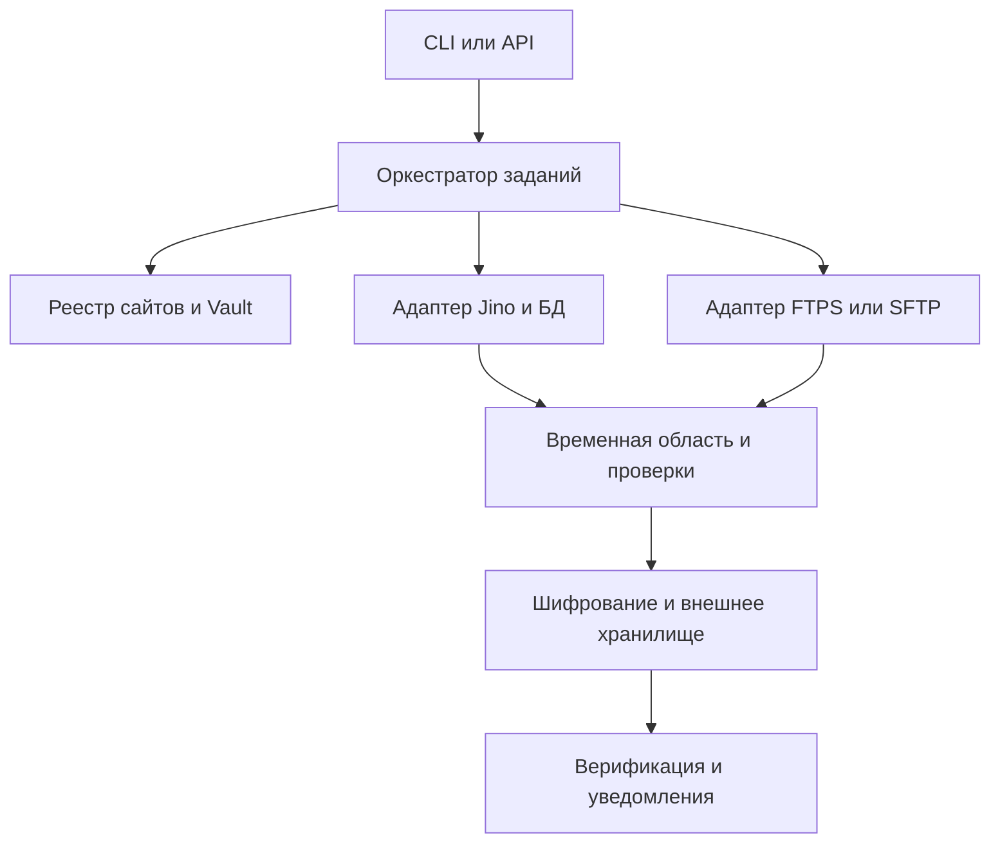

# Архитектура Jino Backup Manager

## Основной принцип

Система запускается на независимом VPS или внутреннем сервере. В клиентском хостинге не нужен постоянный агент. На каждый запуск создаётся временный исполнитель с разрешёнными источниками и отдельным рабочим каталогом.

## Компоненты

| Компонент | Контракт |
| --- | --- |
| `orchestrator` | Создать `BackupJob`, проверить блокировки, выбрать стратегию, контролировать этапы и тайм-ауты. |
| `site_registry` | Сопоставить клиент/сайт/корень/аккаунты/БД/политику; не содержит сами пароли. |
| `secrets_provider` | Выдать на время работы значение секрета по ссылке; не раскрывать его в API. |
| `jino_panel_adapter` | Войти легитимным способом, создать/выбрать снимок, проверить готовность, вывести результат в отдельную папку. |
| `transfer_adapter` | Читать удалённое дерево FTPS/SFTP, сохранять пути, обрабатывать resume и ограничения каналов. |
| `db_adapter` | Получить дамп из Jino, через прямой MySQL/PostgreSQL или SSH, проверить полноту. |
| `artifact_verifier` | Хэши, структура архива, SQL-валидация, контроль числа файлов, обнаружение аномалий. |
| `storage_adapter` | Шифрование, загрузка новых версий, защита от удаления, проверка чтения. |
| `notifier` | Отчёты оператору, сообщения об ошибках, события безопасности. |

## Приоритет способов получения БД

| Метод | Требуемый доступ | Плюсы | Ограничения |
| --- | --- | --- | --- |
| A: Jino Panel Snapshot | Панель Jino | Штатный снимок файлов и БД, возможна единая точка времени | UI может измениться, фоновая задача занимает время |
| B: Direct DB | Доступ БД по разрешённому IP/сети | Новый дамп без панели | По умолчанию внешний MySQL закрыт; нужна согласованность с файлами |
| C: SSH Dump | Доступ SSH | Подходит для больших БД и архивирования | SSH может не быть подключён |
| D: One-time PHP exporter | Отдельное одобрение, PHP и локальный доступ к БД | Возможен без панели, если доступно исполнение PHP | Повышенный риск; исключение, не основной метод |
| E: Files only | FTPS/SFTP | Сохраняет доступные файлы | `FILES_ONLY`, не полный бэкап |

**В режиме `auto`:** определить доступные разрешённые методы по preflight, выбрать A, B или C; D разрешать только как явно согласованный режим. При отсутствии БД сохранять файлы с состоянием E и инцидентом полноты.

## Рекомендуемый стек

- Python 3.12+ для оркестратора и адаптеров.
- Playwright для действий в текущей веб-панели Jino с явными проверками экрана/состояний.
- rclone с поддержкой FTPS или отдельный проверенный клиент SFTP/FTPS для загрузки файлов.
- `mysqldump` или `pg_dump` для разрешённого логического экспорта; версии утилит согласовать с версией БД.
- PostgreSQL для реестра, заданий и метаданных. Для одиночного прототипа возможна SQLite.
- S3-совместимое внешнее хранилище; отдельная политика неизменяемости. Restic допустим для шифрования/дедупликации при совместимости выбранного backend и режима хранения.
- Vault или эквивалентное защищённое хранилище учётных данных.

## Изоляция

Фактическое дополнение прототипа: `panel.py` отвечает за наблюдаемый UI и GraphQL-контракт Jino, `panel_files.py` — за защищённое потоковое HTTPS-скачивание штатного менеджера, `panel_protocol.py` — за разрешённую мутацию, проверки каталога и SQL, `panel_export.py` — за блокировку аккаунта, шифрованный журнал, идемпотентность и `DB_ONLY`. Этот workflow использует существующий снимок, сохраняет обычные локальные SQL по явному выбору пользователя и пока отделён от архивного оркестратора/расписания. [Фактическая интеграционная проверка](11_database_export_integration.md).

1. Для каждого клиента — логически раздельные пространства ключей и артефактов.
2. Исполнитель не получает права удаления старых внешних версий.
3. Служебные аккаунты имеют минимальные права на источник и не используют общий администраторский пароль для всех сайтов.
4. Ни один хостинг-контейнер не имеет доступа к внешнему хранилищу архивов.
5. Восстановление production — отдельный процесс с подтверждением человека, не часть обычного бэкапа.
