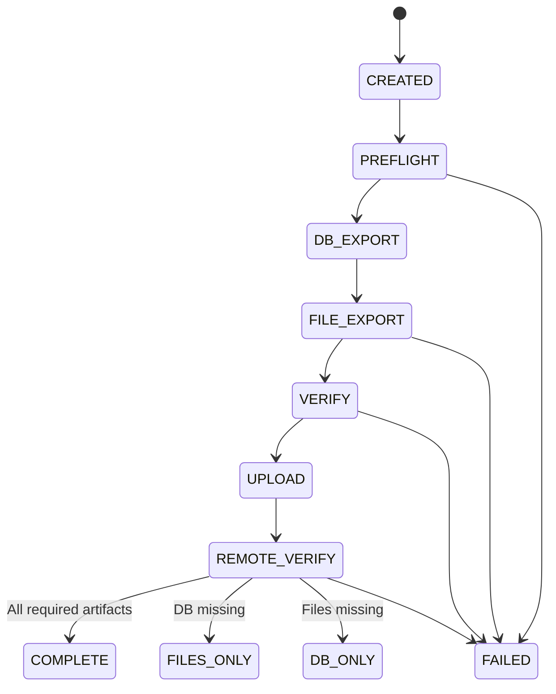

# Алгоритмы и жизненный цикл задания

## Массовое скачивание обычных файлов

Отдельно реализован `backup download-servers` по явному запросу пользователя. Он читает FTP-поля независимо от аккаунтов панели, проверяет однозначность идентификаторов и файловых аккаунтов, последовательно скачивает разрешённые корни в отдельные папки серверов и запусков. Без `--execute --plaintext` выполняется только локальный dry-run.

Промежуточные части и журнал SQLite сохраняются в `.jino-progress` внутри каталога запуска. После записи каждых 8 МиБ данные синхронизируются с диском, затем фиксируется длина и SHA-256 в журнале. При возобновлении проверяются источник и локальная сохранённая часть; неподтверждённый хвост удаляется только из принадлежащего заданию частичного файла. Готовые файлы появляются через атомарное переименование и проверяются перед повторным использованием. Блокировка файловой системы предотвращает одновременную запись одной копии двумя процессами и снимается ОС при завершении процесса.

Манифест `FILES_ONLY` создаётся после завершения передачи и проверки состава дерева. Успешная копия при повторе команды проверяется локально и повторно по сети не скачивается. Новый `--batch-id` создаёт другую копию; изменение уже завершённого исходного файла в незавершённом запуске даёт `SOURCE_CHANGED`, а не незаметную подмену версии. Отказ одного сервера отражается в общем отчёте и не мешает обработке следующих. Недействительный сертификат не повторяется как обычный сетевой сбой. Дампы этот режим не создаёт.

## Состояния задания

Управляемая FTPS-выгрузка теперь использует ограниченную очередь: файлы передаются параллельно уже во время обхода дерева. Лимит 2–5 сеансов включает один сеанс метаданных; общий предел — 10 для управляемого исполнителя. Общий объём остаётся неизвестным до завершения обхода. Сохранение checkpoint, частичный результат и продолжение сохраняют прежний ключ. SFTP и HTTPS используют прежнюю схему. [Реализация и подтверждённые проверки](22_parallel_ftps.md).

В реализованной файловой передаче временный обрыв отдельного подключения, перечисления каталога или скачивания файла получает пять переподключений с задержками 2/4/8/16/32 секунды после первой попытки. Ошибки TLS, host key, авторизации и пути не повторяются как сетевые. Текущий обход сохраняет уже просмотренные каталоги в памяти, а подтверждённые части файлов сохраняются на диске. После исчерпания попыток управляемое задание можно продолжить с тем же ключом. Ожидание, подключение и исчерпание отражаются в журнале и UI. Эта политика не повторяет создание снимков или экспорт БД. [Подробности и подтверждённые границы](19_recovery_and_server_navigation.md).

Дополнительные допустимые состояния: `WAITING_FOR_MFA`, `RETRY_WAIT`, `DB_ONLY`, `STALE_SNAPSHOT`, `CANCELLED`. `FILES_ONLY` может быть завершённым частичным результатом, но **никогда не эквивалентен `COMPLETE`**.

## Основной сценарий `backup.run(site_id, mode=auto)`

1. Создать `job_id`, зафиксировать `idempotency_key`, проверить права оператора, блокировку по сайту и доступность staging/storage.
2. Загрузить профиль сайта, доступные адаптеры и ссылки на секреты. Если не подтверждено сопоставление JSON/FTP-ссылок, остановиться с `PROFILE_UNVERIFIED`.
3. Preflight: доступный корень FTPS/SFTP, список ожидаемых баз, свободное место, поддерживаемая СУБД, разрешённый способ экспорта.
4. Выбрать стратегию БД. Для панели — создать свежий снимок, получить его ID и время, дождаться завершения. Для прямого БД/SSH — экспортировать с согласованной стратегией транзакций.
5. Получить дампы всех привязанных БД. Сохранить: тип и версию СУБД, способ экспорта, время начала/окончания, размеры, количество таблиц, статус первичной проверки.
6. Скачать файловое дерево или архив соответствующего снимка. Учитывать скрытые файлы, символические ссылки, лимиты и изменения во время передачи.
7. Построить `manifest.json`: источники, реальные времена снимков, охват файлов/БД, предупреждения и список артефактов.
8. Проверить размеры/контрольные суммы, структуру архива, признаки SQL-дампа и обязательные каталоги. Сбой не переводить в `COMPLETE`.
9. Зашифровать пакет, записать в независимое хранилище, проверить контрольные суммы и чтение объекта, назначить политику удержания.
10. Закрыть браузерную сессию, соединения БД и FTP/SFTP. Очистить временную область. Если использовался одноразовый PHP-экспортёр — удалить и подтвердить отсутствие.
11. Зафиксировать результат и отправить уведомление. Для `FILES_ONLY`, `DB_ONLY` и `STALE_SNAPSHOT` указать точную причину неполноты.

## Реализованная выгрузка SQL существующего снимка

Папки серверов обоих файловых workflow теперь называются по логинам исходных записей; внутренние идентификаторы и checkpoints сохраняются. Выполненный перенос старых папок и проверка продолжения описаны [отдельно](12_login_folder_names.md).

`backup export-jino-db` реализует отдельный `DB_ONLY` workflow: штатный вход → проверка единственного контейнера и выбранной даты → чтение всех БД снимка → проверка HTTPS-транспорта → последовательный экспорт SQL в явно показанный `/backups/дата` → ожидание стабильного файла и завершения backup-задачи → скачивание → проверка размера, структуры SQL, SHA-256 и чтения локальной копии. Используются наблюдённые операции текущей панели, а не предполагаемые endpoints. Успех проверен на одном разрешённом аккаунте: [журнал](11_database_export_integration.md).

Перед экспортом каталог сверяется с известными результатами задания; чужие файлы запрещают продолжение. Исходный список и фаза `SUBMITTING` сохраняются зашифрованными до операции. После сбоя повторный запуск с тем же ключом не отправляет неопределённую операцию ещё раз: он сверяет появившийся результат. Частичный SQL сохраняется, следующая передача идёт в новую часть с начала. Полный сохранённый файл с ожидаемым размером и корректными маркерами SQL может быть повторно проверен и скопирован без сетевого скачивания; исходная часть остаётся. После финального переименования намерение фиксации позволяет восстановить журнал при остановке процесса. Готовое задание проверяет файлы локально без новой авторизации.

HTTPS-транспорт использует токен в заголовке, проверку сертификата и запрет редиректов; байты SQL не попадают в логи. Панельный источник сопоставлен с контейнером явно, независимо от FTP-профиля. Создание нового снимка пока остаётся отдельным пилотным действием; команда требует существующую дату и не включена в `auto`. По прямому указанию пользователя SQL и неудачные части сохраняются (`KEEP_REMOTE`); удаление не выполняется.

## Сценарий A — целевая полная резервная копия через панель Jino

1. Открыть известную страницу панели с проверкой TLS; при необходимости пройти штатную авторизацию. MFA/CAPTCHA — ожидание оператора, не обход.
2. Проверить, что аккаунт панели сопоставлен с нужным сайтом и что выбрано **создание** свежего снимка. Не путать с восстановлением поверх сайта.
3. Запустить создание копии и ожидать состояния готовности; у события должен быть уникальный ID или проверяемая связка дата/размер/список объектов.
4. Выгрузить выбранные файлы и SQL в отдельную папку `backups/дата` согласно текущему безопасному сценарию панели Jino.
5. Получить их FTPS/SFTP, зафиксировать дату исходного снимка, а не момент выгрузки.
6. При изменении UI — остановить адаптер с `UI_CHANGED`, не продолжать последовательность случайными кликами.

**Ограничение:** действующий UI на реальном тестовом аккаунте не проверен. Поэтому селекторы, URL, тексты кнопок, формат статуса и правила ожидания являются предметом технического spike.

## Сценарий B — FTP/SFTP плюс прямой экспорт БД

1. Получить разрешённые параметры БД из vault или из конфигурации CMS, если владелец дал согласие на такое чтение.
2. Использовать отдельного пользователя БД с минимально достаточными правами.
3. Для MySQL/InnoDB применять согласованный транзакционный дамп (`--single-transaction` при применимости); для нетранзакционных таблиц зафиксировать ограничения и другой режим блокировок/снимка.
4. Скачать файлы максимально близко по времени к экспорту. Если изменения файлов и БД не синхронизированы, явно пометить консистентность как `BEST_EFFORT`.

## Сценарий C — SSH

Экспортировать через `mysqldump`/`pg_dump`, не помещая пароль в аргументы CLI и логи. Перенести архив защищённым каналом, проверить целостность и удалить только созданный данным запуском временный файл. Подключение SSH должно быть заранее разрешено владельцем.

## Сценарий D — разовый PHP-экспортёр

Использовать исключительно после отдельного разрешения, когда нет панели/SSH/прямого доступа к БД, но выполнение PHP на сайте возможно и допустимо. Запрещён универсальный PHP-shell или код для исполнения произвольных команд. Установить фиксированную функцию экспорта, одноразовый токен, IP-ограничение, HTTPS, ограниченный TTL, лог и проверяемое удаление. Невозможность удалить экспортёр — критический инцидент, требующий ручного вмешательства.

## Ошибки, тайм-ауты и повторы

Для управляемого параллельного FTPS предел пяти переподключений уточнён: при росте подтверждённого смещения своего файла счётчик сбрасывается. Пять переподключений через 2/4/8/16/32 секунды ограничивают застой; срок задания остаётся ограниченным 24 часами. Журнал показывает код libcurl и продвижение конкретного файла; исходная строка исключения не сохраняется. Каталоги и последовательные CLI сохраняют прежний режим. [Разбор отказов и проверка докачки больших файлов](24_large_file_recovery.md).

| Код | Действие |
| --- | --- |
| `AUTH_FAILED` | Не повторять бесконечно; уведомить владельца реквизитов. |
| `MFA_REQUIRED` | Перейти в `WAITING_FOR_MFA` с предельным временем ожидания. |
| `UI_CHANGED` | Остановиться до проверки нового UI и обновления тестов. |
| `DB_UNAVAILABLE` | Сохранить файлы как `FILES_ONLY`, если это разрешено политикой. |
| `SNAPSHOT_TIMEOUT` | Остановить ожидание; не начинать опасные повторные действия без проверки фактического результата. |
| `TRANSFER_INTERRUPTED` | Повтор с учётом resume и хэшей. |
| `INTEGRITY_FAILED` | Поместить артефакт в карантин, не выдавать `COMPLETE`. |
| `CLEANUP_FAILED` | Уведомить оператора, особенно для удалённых временных экспортёров. |

Ретраи используют экспоненциальную задержку и предел попыток, но не повторяют подтверждённые операции панели без проверки их результата. Все шаги журналируются в пределах `job_id`.
