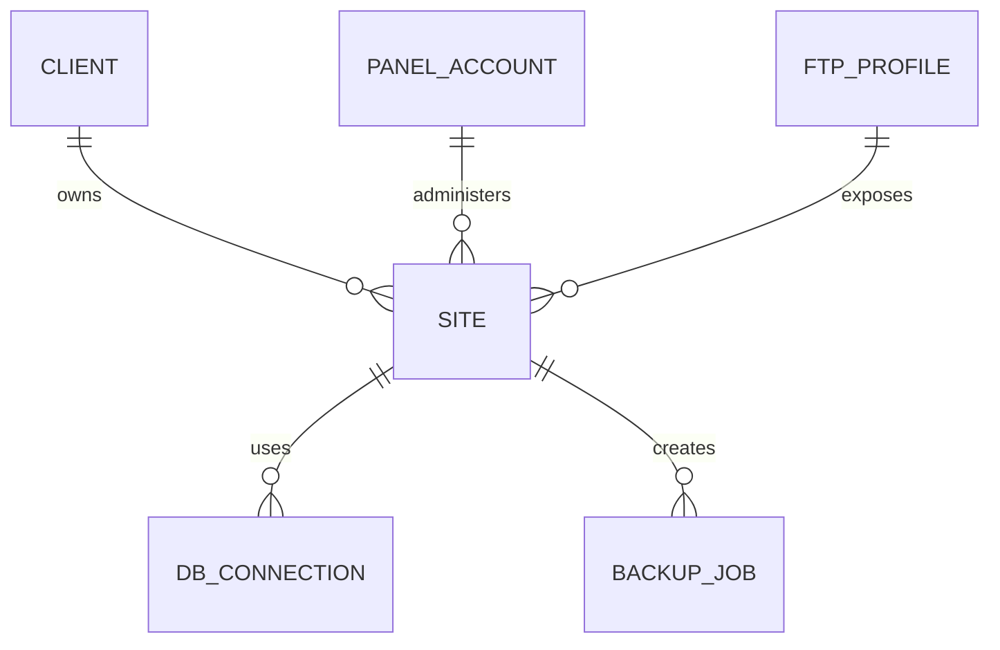

# Интеграция с Jino и существующими источниками

## Что известно о Jino

Дополнение текущего этапа: после [первичного пилота](10_download_and_panel_pilot.md) реализован панельный адаптер приложения для выгрузки MySQL из существующего снимка. На одном разрешённом аккаунте экспортированы и скачаны все 3 БД; результат `DB_ONLY`, серверные SQL сохранены по указанию пользователя. Передача выполнена штатным HTTPS-файловым менеджером Jino с проверкой TLS и явной привязкой `objectId` к контейнеру, поскольку FTPS не прошёл проверку. Наблюдаемые запросы и публичный код текущего UI использованы как проверяемый контракт, а не как обещание стабильного API. [Подробный журнал](11_database_export_integration.md). Создание нового снимка командой приложения, другие аккаунты и восстановление приложения не подтверждены.

Из официальной справки следует:

- Jino поддерживает FTP, FTPS, SFTP и управление файлами через панель. Для работы рекомендуется защищённое соединение.
- В панели есть раздел резервных копий, включая ручное создание снимка. Для сохранения выбранной копии её файлы можно получить в `backups/дата` и загрузить по FTP/SFTP; SQL-дампы также можно получить из копий.
- MySQL можно экспортировать через phpMyAdmin или при наличии SSH. Доступ к MySQL извне по умолчанию закрыт и требует настройки разрешённых IP.
- Существующие снимки Jino имеют собственную дату. Важно отличать новый снимок от архивного.

Ссылки на первоисточники см. в [08_sources.md](08_sources.md).

## Проверка старого `money.py`

Переданный скрипт:

1. Открывает `auth.jino.ru` через `requests.Session`.
2. Находит CSRF-токен в HTML/JavaScript регулярным выражением.
3. Посылает запрос авторизации, затем обращается к `cp-hosting.jino.ru`.
4. Выполняет запрос GraphQL `SpectrumServices` к `graphql.jino.ru/user/` для получения сведений о стоимости сервисов.

**Вывод:** код показывает концепцию авторизованного доступа к панели, но не содержит API резервных копий. Наличие GraphQL-операции стоимости не доказывает доступность GraphQL-метода создания бэкапа.

В новую реализацию не переносить:

- `sess.verify = False` и `verify=False`;
- передачу паролей в командной строке, даже в base64;
- регулярные выражения, жёстко привязанные к скрипту на странице;
- отсутствие строгой проверки кодов ошибок, результата логина, MFA и завершения операций;
- использование неофициального недокументированного endpoint без контрактных тестов.

**Рекомендуемая замена:** Playwright с отдельным модулем авторизации, явной проверкой текущего состояния UI и человеком в контуре для MFA. Если будет найден и подтверждён стабильный разрешённый API Jino, его можно использовать как отдельный адаптер с версионированными тестами.

## Импорт `abw_sibds__server.json`

Это **основной источник учётных данных панели Jino**, указанный владельцем проекта. Формат — JSON-дамп таблицы MySQL с именем `abw_sibds__server`.

При подготовке SDD 1.1 файл не был предоставлен. 10 ноября 2026 года выполнено локальное исследование загруженного файла: точная таблица содержит 56 записей и 24 строковых поля. Поля `id`, `login`, `password`, `ftp_host`, `ftp_login`, `ftp_password`, `mysql_host`, `mysql_login`, `mysql_password` присутствуют. Пригодность значений для авторизации и смысл неполных связей не проверялись. [Результаты исследования](09_local_validation.md) содержат только структуру и количества.

В прототипе карта задаётся JSON-файлом: [пример](../examples/jino-mapping.json). Обязательные ключи `id`, `login`, `password` содержат разные имена колонок; необязательные FTP/MySQL-группы описывают отдельные профили. Порты и протокол в примере — настройки оператора, а не подтверждённые возможности аккаунта. Без карты `import-jino` выполняет только исследование структуры; `--confirm` без карты возвращает `MAPPING_REQUIRED`.

### Задачи импортёра

1. Принять JSON-файл только из локального пути администратора или защищённого upload; не хранить его в git, логах и базе заданий.
2. Распознать известные классы SQL JSON export: массив записей-строк; объект с массивом `data`; структуру с метаданными таблицы и массивом `data` (например, экспорт phpMyAdmin). Не угадывать произвольные вложенные структуры.
3. Если файл содержит несколько таблиц, выбрать **только** точно совпадающую `abw_sibds__server`. При неоднозначности выдать `SOURCE_TABLE_AMBIGUOUS`.
4. Провести инвентаризацию **имён полей, типов, доли null и количества строк**, не печатая значения секретных полей.
5. Применить явную карту столбцов к нормализованной модели `PanelAccount` (см. ниже); если обязательные поля не определены, выполнить только `dry-run`.
6. Провести сопоставление записей таблицы с `Site` и FTP-профилями; конфликтующие или неполные привязки пометить `NEEDS_REVIEW`.
7. Поместить извлечённые пароли и другие секреты непосредственно в vault; в БД приложения сохранить только `secret_ref`.
8. Проверить возможность штатной авторизации **только после отдельного разрешения оператора** и с ограничением числа попыток.
9. Вывести отчёт: `rows_total`, `accounts_valid`, `accounts_ambiguous`, `missing_credentials`, `duplicate_accounts`, `schema_warnings` без секретных значений.

### Карта полей для конкретного дампа

Поля справа в следующем примере являются **маркерами для последующей настройки**, а не утверждением о фактической схеме таблицы:

```yaml
source:
  format: mysql_json_dump
  table_name: abw_sibds__server
mapping:
  external_account_id: "<actual_column_for_id>"
  panel_login: "<actual_column_for_login>"
  panel_password: "<actual_column_for_password>"
  customer_ref: "<actual_column_for_customer_if_present>"
  site_ref: "<actual_column_for_site_if_present>"
normalization:
  domain_lowercase: true
  trim_whitespace: true
  credentials_storage: vault_only
```

После получения файла карта должна быть утверждена, а имена полей и их смысл зафиксированы в отдельном тестовом fixture **без реальных паролей**. Если поле пароля содержит необратимый хэш, importer сообщает `CREDENTIAL_NOT_RECOVERABLE` и не пытается авторизоваться по нему.

### Границы доверия

JSON-файл рассматривается как **секретный исходный материал**. Формат и имена полей не дают автоматически права использовать все аккаунты: у оператора должно быть подтверждённое разрешение обслуживать конкретные сайты клиентов. Пароли могут совпадать с FTP-паролями, но это проверяется в профиле, а не предполагается.

## Импорт `sites (9).xml`

Исторические сведения SDD о `sites (9).xml`: 43 подключения, из них 37 Jino и 6 других. Этот файл в текущей папке отсутствует. Загружен другой файл — `sites.xml`; строгий XML-разбор остановлен с `SOURCE_XML_INVALID` (строка 126, столбец 44). Количество профилей не подтверждено успешным разбором. Прототип выводит только код и позицию ошибки, не исправляет XML и не раскрывает содержимое строки.

**Роль:** источник сведений о FTP-подключениях (хост, порт, пользователь, удалённая директория, режим защиты), не замена `abw_sibds__server.json`.

Рекомендуемая схема сопоставления: `Client → Site → Jino PanelAccount → FtpProfile → DbConnection[]`. Одинаковые хосты могут обслуживать разные сайты или директории; сопоставление по одному имени хоста небезопасно.



## Контракт Jino Panel Adapter

```text
authenticate(account_ref) -> Session | MFA_REQUIRED | AUTH_FAILED
discover_capabilities(session) -> PanelCapabilities
create_snapshot(session, scope) -> SnapshotReference
wait_snapshot(snapshot_ref, timeout) -> SnapshotReady | SNAPSHOT_TIMEOUT
prepare_export(snapshot_ref, items, destination) -> ExportReference
wait_export(export_ref, timeout) -> ExportReady
logout(session) -> Result
```

Любое действие, похожее на «восстановить», должно явно проверять конечную папку назначения. Операция, затрагивающая production, запрещена в backup workflow. Селекторы UI должны иметь тесты на текст, контекст и предполагаемую страницу.

## Технический spike перед реализацией

На отдельном разрешённом тестовом аккаунте проверить: актуальный login flow, MFA, тип Jino-продукта, существование кнопки создания новой копии, SQL-экспорт, время появления в `backups/`, возможность скачать готовые файлы по FTPS/SFTP, ограничения размера и сетевые лимиты. Сохранить **обезличенные** HAR/логи с удалением токенов, паролей и cookies. До проверки не фиксировать внутренние API как стабильные.
