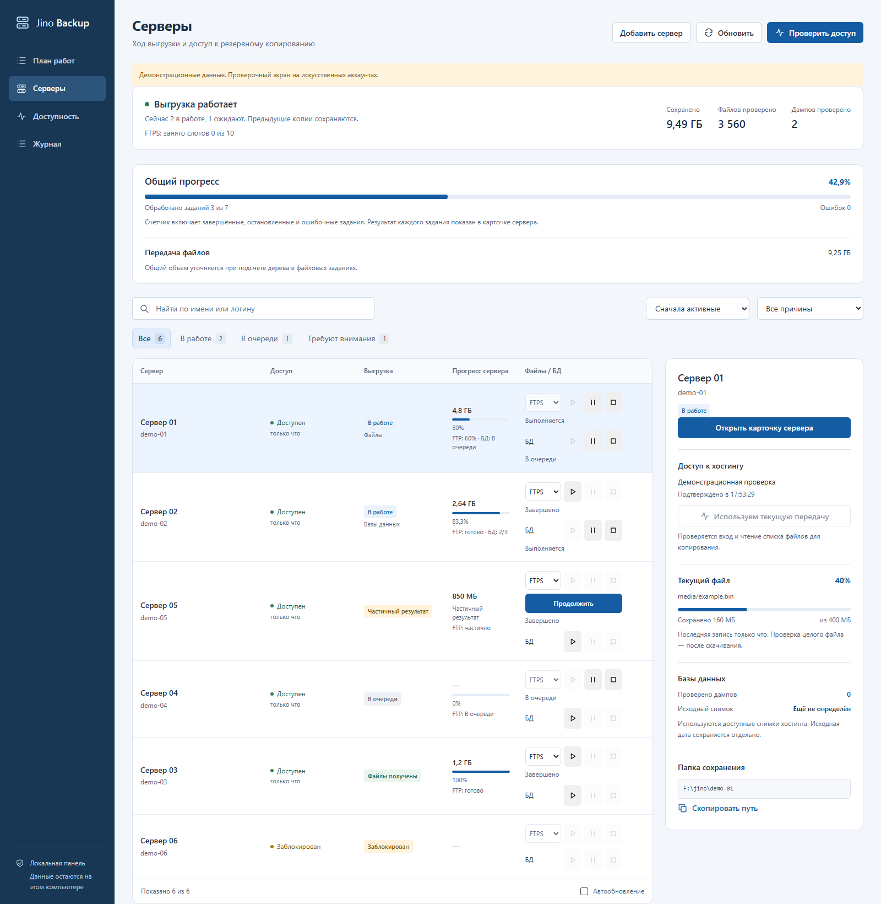

# Актуализация документации и снимок интерфейса

12 ноября 2026 года документация сверена с локальными исходниками, CLI и сохранёнными результатами проверок. Работающий исполнитель не перезапускался; состояние очереди и клиентские ресурсы для этой задачи не изменялись.

## Что исправлено

- README начинается с текущего локального приложения, снимка интерфейса, возможностей и ограничений. Первый запуск содержит обязательные `--destination` и `--batch-id`; короткая команда помечена как подходящая для уже настроенной папки.
- Разделены обычные копии в `F:\jino` и отдельный архивный режим. Два успешных задания FTP/БД не объявляются автоматически `COMPLETE`.
- Указаны текущие лимиты: два задания на разных серверах, одно на сервер; 2–5 FTPS-сеансов на профиль, общий предел 10. Допуск панели — один вход в час, три за три часа, остановка на CAPTCHA; старые самостоятельные CLI этим допуском не охвачены.
- Обновлены сведения о параллельном скачивании во время обхода, совокупном прогрессе сервера, пропусках имён, докачке и безопасных кодах libcurl.
- В архитектуре отделён фактический стек Python/SQLite/PycURL от вариантов следующего этапа: PostgreSQL, rclone/restic и S3 не объявлены подключёнными.
- План реализации дополнен фактическим состоянием. Создание свежего снимка, панельный экспорт в архивном `auto`, retention, внешние уведомления и восстановление приложения остаются незавершёнными функциями.
- Исторические сведения об отсутствующих `money.py` и `sites (9).xml` не выдаются за новую проверку. Реальный `sites.xml` по-прежнему отмечен как синтаксически некорректный.
- Отчёты первых этапов сохранены с датами. Прошлые PID и промежуточные состояния явно отделены от текущего исполнителя; старые результаты тестов не подменены задним числом.
- В README, индексе, плане, локальной валидации и AGENTS указан последний выполненный полный прогон: 292 passed, 1 skipped, 48,26 с; после уточнения фильтрации — 57 passed в затронутых модулях. В этой задаче полный pytest повторно не запускался: изменялись документация и вспомогательный скрипт снимка.

## Сверка с реализацией

Проверены аргументы `backupctl --help`, `ui --help`, `backup export-jino-db --help`, парсер в `cli.py` и зависимости в `pyproject.toml`. Настройки очереди, экспорта и лимитов сверены с `dashboard_management.py`, `dashboard_runner.py`, `parallel.py`, `retry.py` и `downloads.py`. Результаты интеграций взяты из датированных отчётов 11, 13, 16, 22 и 24, без новых живых испытаний Jino. Актуальность всех внешних ссылок и доступов в этой задаче не проверялась.

## Снимок без клиентских данных



Изображение создано из действующих статических ресурсов и HTTP-контрактов приложения, с отдельным временным состоянием и **искусственными** аккаунтами «Сервер 01–06», `demo-01–06`. Реальные имена, логины, адреса, пути, пароли и журналы не читались. Присутствует заметная подпись о демонстрационных данных; это не снимок текущих выгрузок и не доказательство интеграции с Jino.

Воспроизведение из корня проекта, с установленными extra `panel` и Chrome:

```powershell
.venv\Scripts\python.exe scripts/capture_readme_screenshot.py
```

Скрипт создаёт только искусственные файлы в отдельном `.test-tmp/readme-preview-*`, отключает запуск работников, открывает сервер на случайном порту `127.0.0.1`, запрещает браузеру запросы за пределы этого адреса и изменяющие запросы. После снимка закрывает браузер, HTTP-сервер и ресурсы панели. Рабочий порт 8765 не используется. Результат — `docs/images/dashboard.png`; повторный запуск заменяет только этот демонстрационный снимок.

Выполненный прогон подтвердил шесть искусственных аккаунтов, отсутствие отправленных внешних запросов и ошибок JavaScript; блокировка внешних запросов сработала. Проверено отсутствие горизонтального переполнения; изображение 1600 × 1640 просмотрено вручную.

Проверены 29 Markdown-файлов: 127 локальных ссылок разрешаются в существующие файлы, битых ссылок нет. Все 33 CLI-примера README разобраны текущим `argparse` без выполнения команд, входов или экспорта. Вспомогательный скрипт прошёл компиляцию Python, `git diff --check` не выявил ошибок пробелов. Полная доступность внешних веб-страниц и новый полный прогон pytest не входят в доказательства этой проверки.
