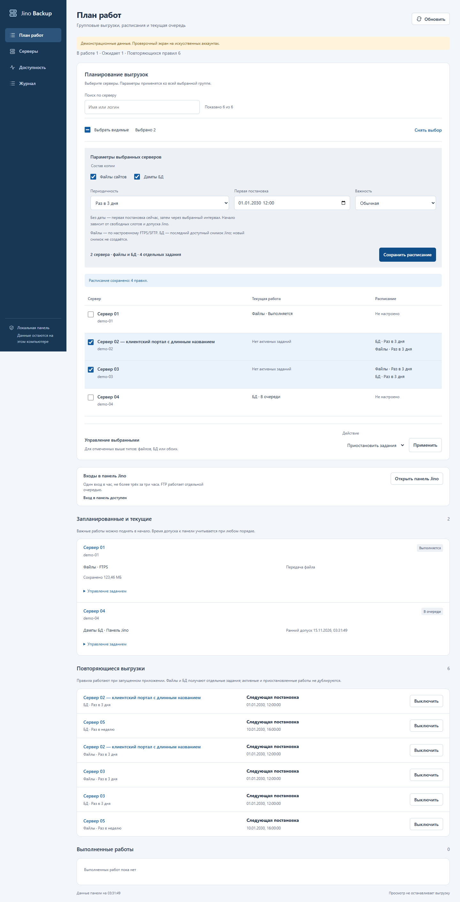

# Групповые операции и периодичность в плане работ

Актуальная компоновка формы по образцу карточки БД и постоянно видимое расписание описаны в [45](45_work_plan_interface.md). Двухколоночная форма ниже относится к первоначальному варианту; API и интервалы продолжают действовать.

Вкладка **«План работ»** предназначена для выбора серверов, общей постановки файлов/БД, управления текущими заданиями и повторяющихся правил. Сохраняются существующие палитра, Segoe UI и оболочка приложения. Обобщённые графики скрыты только на этом маршруте, чтобы первым был выбор операции; таблица серверов и её карточки не перерабатывались.

*Синтетический экран, 15 ноября 2026 года. Реальные аккаунты и расписания клиентов при съёмке не использовались.*

## Работа с группой

1. Найдите серверы по имени или логину и отметьте их галочками. «Все доступные в списке» выбирает текущую поисковую выдачу. Ранее выбранные скрытые строки остаются в группе; её полный размер показан над списком.
2. Отметьте файлы и/или БД. Файлы выбраны изначально, БД выключены. Для каждого выбранного сервера БД означает отдельное задание всего доступного аккаунту набора из последнего существующего снимка Jino, не создание свежего дампа. Исходная дата снимка сохраняется.
3. Выберите первый запуск, важность и период либо «Не повторять». Без даты постановка разрешена сразу. При повторении пустая дата также означает первую постановку сейчас.
4. Добавьте в очередь либо сохраните расписание. Перед отправкой показан состав и количество отдельных заданий. Если работа того же вида уже активна, она не дублируется и сохраняет свои параметры; изменить время существующего ожидающего задания можно в его раскрываемом управлении.

Файлы используют настроенный FTPS/SFTP каждого сервера; общего принудительного переключения всех профилей на один протокол нет. Сервер без нужного доступа нельзя добавить к новой группе этого состава. Если он уже был выбран до включения БД, его можно снять отдельно, сохранив остальной выбор.

В той же форме доступны групповые пауза, продолжение, остановка заданий, включение/выключение правил плана. Действие относится к выбранным серверам и отмеченным типам — файлам и/или БД. Остановка не удаляет скачанные данные. Продолжение частичного файлового результата использует прежний ID и checkpoint. Ручная будущая постановка продолжения не расходует 24-часовой срок передачи до начала выполнения. Индивидуальные расписания конкретных БД из карточки остаются отдельным механизмом.

## Фиксированные периоды

Пользователь выбрал длительности, а не календарные месяцы. Месяц равен 30 дням, год — 365 дням.

| В форме | Интервал, часов |
| --- | ---: |
| Каждые 3 часа | 3 |
| Каждые 6 часов | 6 |
| Каждые 12 часов | 12 |
| Раз в день | 24 |
| Раз в 3 дня | 72 |
| Раз в 5 дней | 120 |
| Раз в неделю | 168 |
| Раз в 2 недели | 336 |
| Раз в месяц, 30 дней | 720 |
| Раз в 3 месяца, 90 дней | 2160 |
| Раз в 6 месяцев, 180 дней | 4320 |
| Раз в 9 месяцев, 270 дней | 6480 |
| Раз в год, 365 дней | 8760 |

## Повторяющиеся правила

Для каждой пары «сервер / вид работы» сохраняется правило, связанное с текущей `binding_revision`. Следующая дата обозначает постановку в очередь, а не обещанное время начала или окончания. Исполнитель должен работать. Сохраняются лимиты пяти файловых заданий, одного БД-задания, 10 сеансов и панельного допуска/CAPTCHA.

При простое приложения пропущенные интервалы объединяются в одну постановку, следующая дата продвигается за текущее время. Активная, ожидающая или вручную приостановленная работа того же типа не дублируется. Для нового периода файлов создаётся отдельная версия с новым ID; предыдущие копии не удаляются. БД того же существующего снимка могут использовать ранее проверенные SQL по прежним правилам — новая дата скачивания не делает снимок свежим.

Постоянная ошибка ранее созданного правилом задания — TLS, доступы, небезопасный путь, `UI_CHANGED`, MFA/CAPTCHA, внутренняя ошибка — отключает автоматические последующие попытки этого правила до действия оператора. Для `DB_INTEGRITY_FAILED` сначала выполняется [отдельный бюджет повторных скачиваний](43_database_integrity_redownload.md); правило отключается после его исчерпания. Смена привязки также не переносит правило на новый доступ. Старое и новое правила различаются по ID; кнопка отдельного правила управляет только им.

## Контракты и сохранность

`POST /api/plan/bulk`: `rows` (1–500 целых номеров), `files` и `databases` (boolean, хотя бы один true), `every_hours` (null для разовой операции либо один из 13 интервалов), `scheduled_at` (необязательная ISO-дата с часовым поясом), `priority`, `request_id`. Валидируется вся выбранная группа до постановки. Правила группы сохраняются одной транзакцией. Повтор того же запроса возвращает прежний результат; использование ID с другим payload отклоняется.

Одноразовая постановка хранит прогресс запроса и ссылки на уже активные/продолжаемые задания в SQLite. Потеря ответа после окончания короткой продолженной работы не создаёт новую копию. Идентификатор запроса сохраняется в браузере для повтора ошибки и сбрасывается после успешного явного сохранения; новая осознанная команда может применить те же параметры заново.

`POST /api/plan/action`: `rows`, выбранные `files`/`databases`, `action` из `pause`, `resume`, `stop`, `disable_schedule`, `enable_schedule`; для отдельного правила — `rule_id`. Правила и результаты запросов хранятся в таблицах `work_rules` и `work_requests` существующей SQLite. Пароли, cookies и дампы туда не записываются. `GET /api/plan` дополнен `rules`; приватная панель показывает имена и логины, публичные отчёты не расширялись.

Состояние выбора, открытое управление заданиями и редактируемая дата переживают обновление. На время запроса изменяющие действия отключены; ошибка сохраняет введённые параметры и возможность повтора. Расписания реальных клиентов самостоятельно не включаются.

## Проверки

Полный прогон перед заключительными уточнениями: **392 passed, 1 skipped**, 68,94 с. После них проверены **22 сценария нового плана** вместе с регрессиями управления заданиями — **60 passed**, 27,01 с. Покрыты все интервалы, повтор запроса, проверка всей группы, восстановление между созданием задания и продвижением даты, пропущенные интервалы, пауза, постоянный TLS-отказ, смена привязки и будущая постановка продолжения.

`scripts/check_work_plan.py` использует только искусственные аккаунты и отдельный локальный сервер. Chrome: 1440/1000/800/390, отсутствие горизонтального переполнения и ошибок страницы, сохранение скрытого выбора, применение галочки БД ко всей группе, повтор после 503, повторное включение тем же явным сохранением, отсутствие дубля от двойного клика, пауза/продолжение/остановка группы. Все внешние запросы блокируются. Снимки: `.impeccable/review/work-plan-*.png`. Проверки не создают правила на реальных клиентах и не подтверждают завершение их копий.

Механический detector запускался один раз; абсолютный `/assets/style.css` не разрешился как файловый путь, поэтому отчёт о чёрном тексте и одинаковых 16px не соответствует браузерным снимкам. Независимый дизайн-ревьюер вынес **ship** на проверенную поверхность. Documenter подтвердил наследование системы без новых токенов; `DESIGN.md` и его sidecar не переписывались.

## Установка

Протокол `.state/work-plan-deployment.json`, фаза `RESTORED`: восстановлены пять активных и 21 ожидающее задание, сохранены 26 ID очереди. Дополнительная проверка SQLite подтвердила сохранение всех 58 ID и двух ручных остановок, новых заданий при установке нет. Реальных правил `work_rules` — 0: настройка клиентов оператором ещё не выполнялась. GET-проверка установленной панели подтвердила новое поле `rules`, 13 периодов, галочку БД и код группового запроса. Это проверка установки, не экспорт всех серверов и не включение их расписаний.
