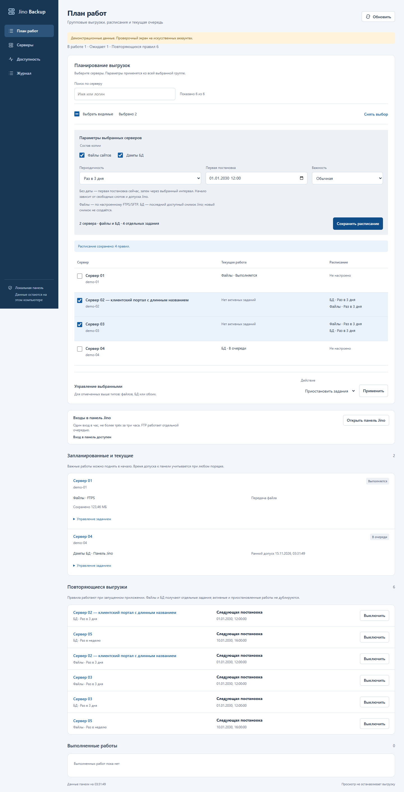

# Планирование в стиле карточки БД

По замечанию пользователя двухколоночная форма в «Плане работ» заменена единой рабочей областью на всю ширину. За образец взята карточка баз данных: поиск, панель выбора строк, те же поля и кнопки, спокойная заливка редактора и выделение выбранных серверов.

Пользователь отдельно подтвердил: **настройка расписания должна быть видна постоянно**. Состав копии, все 13 периодов, первая постановка и важность доступны без раскрытия секции. Кнопка применения находится после полей, рядом с итогом выбора. «Не повторять» добавляет обычные задания; выбранный интервал сохраняет расписание. Месяц по-прежнему равен 30 дням, год — 365.

В строках серверов отдельно показаны текущие задания и сохранённые расписания файлов и БД. Отсутствие активной работы не выдаётся за ошибку. Название открывает карточку сервера, галочка или свободная часть строки меняет выбор. Поиск и обновление сохраняют выбор, в том числе скрытый поиском; групповой запрос включает всю выбранную группу.

Управление существующими заданиями и включение/выключение правил находятся отдельно под списком. Эти действия учитывают отмеченный состав копии: файлы, БД или оба типа. Сообщение об ошибке появляется рядом с формой, параметры сохраняются для повтора. На телефоне поля идут последовательно, а строки таблицы показывают подписанные значения.

Изменены только статические HTML/CSS/JS. Очередь и правила реальных клиентов не перенастраивались, перезапуск исполнителя не требовался. Алгоритм интервалов, допуск Jino, защита от дублей и поведение очереди остались прежними — [42](42_work_plan_bulk_schedules.md).

## Проверки

`scripts/check_work_plan.py`: Chrome на ширинах 1440/1000/800/390, постоянно видимые настройки, размеры полей как в БД, длинное название, клавиатурный выбор и фокус, сохранение выбора/даты при опросе, поиск, ошибка 503 и повтор с тем же request_id, двойной клик без дубля, сохранение расписания и групповые пауза/продолжение/остановка. Ошибок страницы нет; 25 POST затронули только отдельный синтетический сервер, внешние запросы заблокированы.

Для каждой ширины синтетическая история заданий очищается между сценариями: остановленные задания предыдущей ширины не должны ошибочно считаться дублями новой постановки. Это изоляция браузерных сценариев, не изменение поведения приложения. Дополнительно прошли 22 теста `tests/test_work_plan.py` и 22 JS-регрессии.

Новый полный дизайн-review: **ship**, без обязательных исправлений (`.impeccable/review/work-plan-restyle-review.md`). Documenter подтвердил наследование существующей системы без обновления глобальных токенов. Detector запускался один раз; его файловый поиск HTTP-пути `/assets/style.css` не прочитал реальные стили, поэтому выводы о дефолтных 16px и чёрном тексте не приняты за браузерные измерения.

Read-only проверка работающей панели подтвердила новые HTML/CSS/JS и пять продолжающихся файловых заданий. Обновлён снимок README, проверены SHA-256 всех пяти изображений. Для остальных четырёх снимков добавлены только метаданные происхождения, пиксели сохранены.

