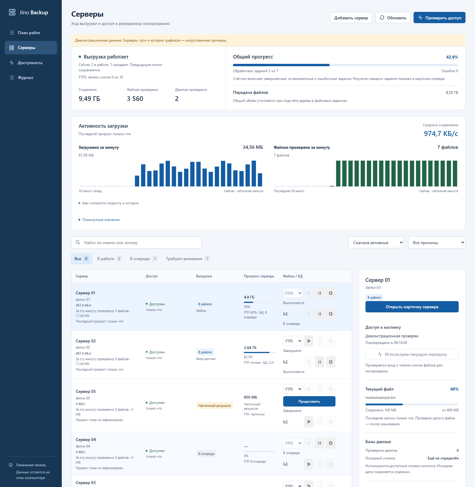
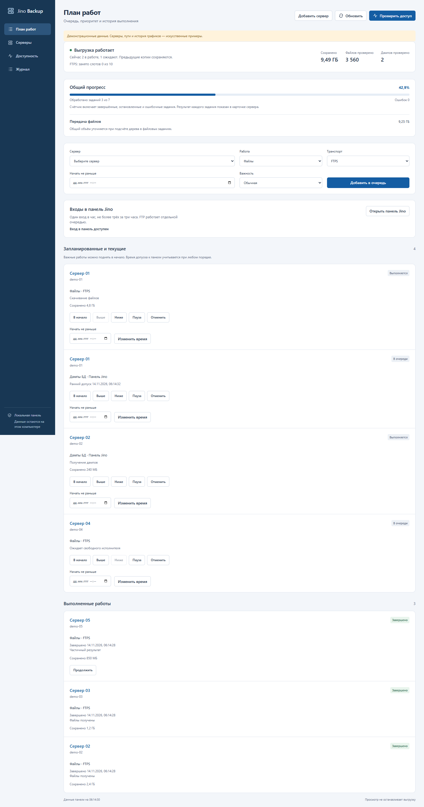
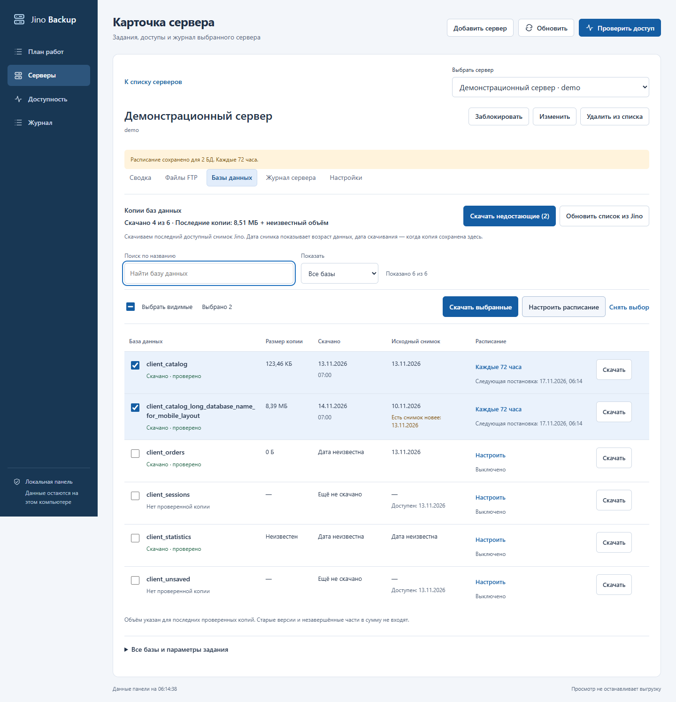
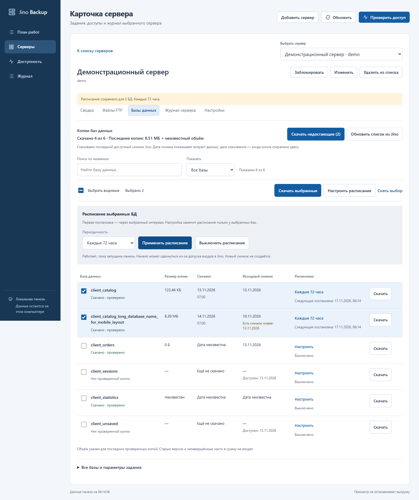
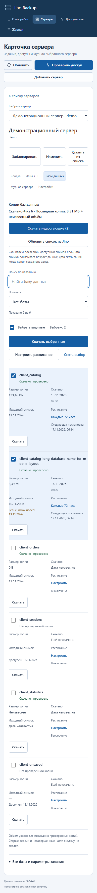

# Скриншоты интерфейса

Снимки заново получены 14 ноября 2026 года из текущего кода. Все серверы, имена БД, состояния, размеры и история графиков демонстрационные. Это примеры интерфейса, а не состояние клиентских копий. Входов в Jino и чтения клиентских доступов при съёмке не выполнялось.

## Серверы

Сводка исполнителя, общий прогресс, минутная активность, таблица серверов и правый блок выбранного сервера.



## План работ

Текущие и ожидающие задания, правило допуска панели и история выполнения. Времена и состояния на снимке искусственные.



## Копии баз данных

Кнопка «Скачать недостающие», выбор нескольких БД, размеры последних проверенных копий, даты скачивания и исходных снимков. Неизвестные значения показаны отдельно; старый снимок не становится свежим после нового скачивания.



## Групповое расписание

Общая форма выбранных БД: каждые 72 часа, раз в неделю или произвольный интервал. Используется последний доступный существующий снимок Jino. Настройка на снимке относится только к синтетическим записям.



## Мобильная карточка

Ширина окна 390 px. Таблица превращается в подписанные строки, действия и даты сохраняются; изображение можно открыть в исходном размере.

[Открыть полный снимок](images/database-mobile.png)



## Воспроизведение

Нужны установленные зависимости `.[dev,panel]` и Google Chrome. Из корня проекта:

```powershell
.venv\Scripts\python.exe scripts/capture_readme_screenshot.py --all
```

Создаются пять PNG и [screenshots.json](images/screenshots.json) со временем съёмки, размерами и SHA-256. Флаг `changed` в манифесте относится к сравнению с файлами перед конкретным запуском. Без `--all` обновляются `dashboard.png` и `work-plan.png`.

Сценарии используют отдельные loopback-серверы и искусственные данные. Основной экран и план разрешают только GET, а проверка БД изменяет лишь свои демонстрационные записи. Внешние запросы блокируются; рабочий исполнитель не перезапускается. [Пользовательская инструкция](../README.md#как-скачать-и-планировать-дампы-бд), [правила копий и расписаний](40_database_catalog_and_bulk_schedules.md).
